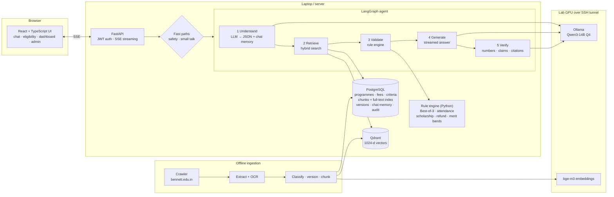

# BENNETT ONE: Design Document

*An assistant that answers questions about Bennett University from official documents, shows the source for every fact, and leaves eligibility decisions to tested code instead of the LLM.*

This document follows the course's design-document template (sections 1–8), then lists the tech stack. The full implementation walkthrough is in [HOW_IT_WORKS.md](../docs/HOW_IT_WORKS.md).

---

## 1. Problem and users

**The problem.** Bennett University's rules are spread across **300+ PDFs, notices, fee tables and web pages**:
- attendance notifications
- exam manuals
- scholarship and refund policies
- academic calendars
- school-specific rulebooks

Some rules have been replaced by newer ones. For example, SCSET's 70% attendance rule was superseded by the university-wide 75% rule. Students rely on seniors and WhatsApp groups, and the myths that spread there cause real problems. We found several on Reddit, e.g. "50% attendance is enough".

| User | Typical task | Success for them |
|---|---|---|
| **Prospective student / parent** | "Am I eligible for B.Tech CSE with these marks?", "What's the fee and scholarship?" | A correct verdict from the official rule, with the fee table and a link to the source |
| **Enrolled student** | "Can I sit the end-sem with 72% attendance?", "Do I keep my scholarship with CGPA 8.2?" | A personalised answer (their school, their ERP data) with the rule and page cited |
| **Admin / faculty** | Upload a new circular, see what it changes | Old versions superseded, conflicts flagged, audit log kept |

**What they must never get:**
- **A wrong eligibility, attendance or scholarship verdict** stated confidently
- **A made-up number:** a fee, date or percentage that isn't in a document
- **An outdated rule** presented as current
- **Help evading rules**, such as proxy attendance or sneaking banned items into the hostel
- **A slow or generic reply to an emergency.** Ragging and self-harm questions get verified contacts immediately.

---

## 2. Why generative AI, and which kind

**Why GenAI at all:**
1. **Questions arrive as free-form text.** Students write things like "72 in OS, 80 in DBMS, can I sit end-sem?" or "PJYSICS 65 AND IT 74". Fixed menus and keyword search can't parse these. An LLM can turn them into structured fields.
2. **The knowledge is unstructured.** It lives in PDFs (some scanned), so the system needs semantic search plus a language model to write readable answers.
3. **The knowledge changes every semester.** That favours retrieval over training (see the table below).
4. **Errors are expensive.** So GenAI is used only where it is strong (understanding and explaining). Python code makes every pass/fail decision.
5. **Privacy and cost.** Student ERP data shouldn't leave campus, so the model runs on a lab GPU at no extra cost.

**Which kind: RAG + deterministic rules (not fine-tuning, not prompting alone)**

| Option | Verdict | Reason |
|---|---|---|
| Prompting only | ❌ | The model doesn't know Bennett's current rules, so it would invent them |
| Fine-tuning | ❌ | Rules change every semester, so retraining for every circular isn't practical. It also can't cite a page, and still hallucinates numbers |
| **RAG** (retrieve passages, then generate) | ✅ | Knowledge stays current by re-indexing. Every answer can cite a document and page |
| **+ Rule engine** | ✅ | Thresholds and arithmetic (Best-of-3, 75%, CGPA ≥ 8.5) are done in tested Python. The LLM only explains the verdict |
| **No AI** (FAQ page) | Baseline | Can't handle personal numbers or follow-ups, and goes stale |

**Baseline we compare against:** our own first end-to-end version, plain hybrid RAG with the same model but without the rule-engine verdict line, numeric guard or claim checks. It scored **21/29 (72%)**; the current system scores **31/31**. (See §7 for the honest caveat.)

---

## 3. Scope

**In scope:**
- Admissions:
  - eligibility (Best-of-3, IB, graduation %)
  - fees for AY 2026-27 (65 programmes)
  - merit scholarship bands
  - admission deadlines
- Academics:
  - attendance rules and personal checks
  - exam / UFM rules
  - academic calendar dates
  - scholarship continuation
  - fee refunds
- Campus life: hostel rules and anti-ragging contacts.
- Letter drafts, e.g. a leave application.
- Admin:
  - document upload and approval
  - version diff
  - conflict queue
  - audit log
- Institutional facts from the University Annual Report 2024-25 (rankings, research, placements, campus).
- 9 schools, 133 programmes, 364 documents.

**Out of scope:**
- Other universities, e.g. "IIT fees"
- Writing to ERP: no applications are submitted and no records are changed
- Final admission decisions: every answer says the decision rests with the University
- Live data that isn't published, e.g. seat availability or results
- Legal or medical advice

**At the boundary:**

| Situation | Behaviour |
|---|---|
| Question about another institution | Polite redirect: "I only cover Bennett University" |
| Not enough information (e.g. "82% in PCM") | Asks for exactly the marks the rule needs, and remembers them for the rest of the chat |
| Answer not in any document | Says so and names the office to contact. **It does not guess** |
| Ragging / self-harm / emergency | **Safety fast path:** verified university and national helplines in < 1 s, without the LLM |
| Greetings, "what can you do" | **Small-talk fast path:** instant reply, without the LLM |

---

## 4. Requirements

### Functional (each one is testable)
| ID | Requirement | How it is tested |
|---|---|---|
| F1 | Every factual sentence cites a source (document + page, or structured fee/policy data) | Eval check `cited`, citation verifier |
| F2 | Eligibility, attendance, scholarship and refund verdicts come from the rule engine, not the LLM | 41 unit tests; eval check `behavior` |
| F3 | Missing inputs → ask for exactly what's missing, never assume | Eval cases adm-01, sch-0x; unit tests |
| F4 | Superseded documents are never used as the current rule | Unit test (SCSET 70% → 75%) |
| F5 | Answers use the student's school and programme; documents from other schools are filtered out | Retrieval filter `school_id IN (mine, ALL)` |
| F6 | Remembers details within one chat (marks, programme, scores) | `tests/test_memory.py` + replayed live conversation |
| F7 | Out-of-scope and safety questions are routed correctly | Eval cases oos-01/02; safety detector |

### Non-functional (with targets)
| Property | Target | Current |
|---|---|---|
| **Latency**: policy question, end to end | median ≤ 25 s on a shared 16 GB GPU; first words visible within ~10 s (streaming) | median **20 s**, p90 30 s |
| **Latency**: greetings / safety | < 1 s | instant (no LLM) |
| **Accuracy** | 0 wrong verdicts on rule questions; ≥ 90% pass on the question set | 31/31 |
| **Freshness** | New circular searchable within a day of upload (admin upload → re-index) | Manual upload + approve; re-crawl is a script |
| **Privacy** | Student data and questions never leave campus | Model and embeddings are self-hosted on the lab GPU; ERP data is git-ignored |
| **Licensing** | Open models only | Qwen3-14B (Apache 2.0), bge-m3 (MIT) |
| **Cost** | ₹0 per query | Runs on an existing lab GPU |

---

## 5. Architecture

**Each component and the requirement it serves:**

| Component | Why it exists (requirement) |
|---|---|
| **Crawler + OCR + versioning** | F4 freshness: every document gets a version, and only the current one is searchable. OCR is needed because many notices are scanned images |
| **PostgreSQL** (structured tables + full-text index) | F1: fees, criteria and policy facts as exact data. Keyword search catches codes like "BU/RO/307" |
| **Qdrant** (vectors) | Finds paraphrases ("end-term" ≈ "end-semester"). Combined with keyword search by Reciprocal Rank Fusion |
| **Understand node** (LLM → JSON) | Turns free text into fields (marks, programme, intent). Merged with **chat memory** (F6) |
| **Rule engine** | F2: deterministic, unit-tested verdicts. The LLM can't do reliable arithmetic or apply thresholds consistently |
| **Generate node** (streaming) | Readable answer; streaming keeps the 20 s wait visible and tolerable |
| **Verify node** | F1 + "never a made-up number" (see §6) |
| **Fast paths** | Safety (< 1 s for emergencies) and latency for small talk |
| **Self-hosted LLM over SSH** | Privacy, licensing and ₹0 cost. Swapping providers is a `.env` change (OpenAI-compatible API) |
| **Admin console** | Human control over which documents become "official" |

---

## 6. Failure modes and guardrails

| What can go wrong | Guardrail | Real example it caught |
|---|---|---|
| LLM recomputes a number differently | **Code writes the verdict line.** A **numeric grounding check** requires every %, ₹ and date to appear in the evidence, otherwise the answer is regenerated once | Rule engine said Best-of-3 = 83.67%, LLM wrote 88% |
| LLM adds an unsupported claim | **Claim-by-claim check:** each factual sentence is judged against the sources; unsupported ones are removed and the user is told | Removed an invented "personal interview" step |
| Outdated rule retrieved | Versioning: only `is_current` documents are searched; conflicts are shown in admin | SCSET 70% vs university 75% attendance |
| Wrong programme matched | Abbreviation map ("cse" → B.Tech CSE) and penalties for PG / dual-degree variants | "cse" was matching M.Tech CSE |
| Bad input | Validation (marks outside 0–100 are rejected); typo matching ("PJYSICS" → Physics) | 450% accepted; typo caused a false "not eligible" |
| Missing information treated as failure | Engine asks for unmentioned compulsory subjects instead of rejecting | Maths 44 + IT 74 + typo'd Physics → wrongly "does not meet" |
| Prompt injection inside a PDF | Sources are wrapped in `<source>` tags and declared as data, not instructions; admin approval before indexing | — |
| Rule-evasion requests | System rule: state the rule and the legitimate route | "How to sneak a kettle into the hostel" → hostel rule 9 |
| Verification removes everything | Fallback answer built from structured data, or "not found, contact X". Never empty | Scholarship answer came back empty |
| GPU busy (shared lab machine) | Keep-warm thread, retries with backoff, self-healing SSH tunnel; keyword-only search if the vector index is unavailable | Tunnel drops during ingestion |

**What limits it / what still gets through:**
- The claim checker is the **same model** as the writer, so it can miss subtle errors.
- **Scanned tables** with OCR errors can still produce a wrong retrieved passage.
- Answers are only as current as the **last ingestion**; there's no automatic re-crawl yet.
- Policy text that isn't converted to a rule (most of the exam manual) is answered by RAG alone, which is weaker than a rule-engine verdict.
- Latency of 10–45 s depends on other people's jobs on the shared GPU.

---

## 7. Evaluation plan

**Test set: 31 real questions**, mostly collected from Reddit and student groups, each with expected facts, known myths, and expected behaviour.

| Slice | # | Examples |
|---|---|---|
| Scholarships | 7 | continuation CGPA, JEE merit bands, amount payable |
| Admissions | 6 | Best-of-3, PCM average, deadlines, documents |
| Attendance | 4 | 72% → end-sem?, "below 75", per-course |
| Fees / refunds | 4 | AY 2026-27 fee, withdrawal refund by date |
| Hostel | 4 | appliances, refunds by day, rules |
| Out of scope | 2 | other universities |
| Exams / UFM, calendar, campus life, multi-turn | 4 | UFM penalty, end-sem dates, follow-up chat |

**Per-stage metrics:**
| Stage | Metric |
|---|---|
| Understand | Intent and slot accuracy (marks, programme), checked through behaviour cases |
| Retrieve | Did the expected source document appear in the cited sources? |
| Validate (rule engine) | **41 unit tests**, including one regression test per bug found; runs in CI on every push |
| Generate + Verify | Per answer: `mention` (key facts present), `myth-free`, `cited`, `behavior` (answer / ask / refuse correctly) |
| End to end | Pass = all four checks; latency per question |

**Results so far:** 21/29 (72%) → 28/31 (90%) → **31/31 (100%)**, median 20 s. Full per-question report: [`data/eval/report.md`](../data/eval/report.md).

**Honest caveat:** this question set guided development, so 100% means "no regressions on known questions". It is not a held-out score.

**Launch thresholds:**
- Before calling it ready: ≥ 90% on a **fresh held-out set** of 20+ questions from other students.
- **Zero** wrong verdicts on rule questions.
- 100% of unit tests passing.

**Human review:**
- Students review a sample of 20 answers for correctness and clarity.
- Admins review every newly uploaded document before it becomes searchable.
- Answers where claims were removed show a visible warning.

---

## 8. Open questions and risks

| Unknown / risk | How we will find out / mitigate |
|---|---|
| Real accuracy on unseen questions | Collect 20+ new questions from classmates and run them without changes |
| GPU availability on demo day (shared lab machine) | Keep-warm, test the morning of the demo; recorded demo GIF as backup |
| Documents changing after our crawl | Re-run the crawler and diff by SHA-256; admin upload for circulars received by email |
| OCR quality on scanned tables | Spot-check OCR'd pages; move critical facts into structured YAML with page citations (already done for fees, attendance, scholarships, refunds) |
| Hindi / Hinglish questions ("attendance kitni chahiye?") | bge-m3 and Qwen3 are multilingual. Add a test slice |
| Official use | It needs the University's approval and an owner who keeps documents current. Until then it is a student project with a disclaimer |

---

## Tech stack

| Layer | Technology | Why |
|---|---|---|
| Language model | **Qwen3-14B** (Q4_K_M, 12k context) via **Ollama** | Best open model that fits a 16 GB GPU; Apache 2.0; OpenAI-compatible API |
| Embeddings | **bge-m3** (1024-d) | Strong multilingual retrieval, runs on the same GPU |
| Agent framework | **LangGraph** | Explicit, inspectable pipeline (understand → retrieve → validate → generate → verify) |
| Backend | **Python 3.12, FastAPI**, SQLAlchemy, SSE streaming, JWT + bcrypt | Async streaming, auto API docs |
| Databases | **PostgreSQL 18** (structured data + full-text search) + **Qdrant** (vectors) | Exact facts and keyword search in SQL; semantic search in Qdrant; fused with RRF |
| Document processing | PyMuPDF, **RapidOCR**, wordninja; custom crawler (robots.txt-respecting) | Text and scanned PDFs from bennett.edu.in |
| Frontend | **React 19 + TypeScript + Vite + Tailwind**, react-markdown | Bennett-branded UI with live agent steps, citations and a source viewer |
| Testing | pytest (41 unit tests), custom eval harness (31 questions), GitHub Actions CI | Regression safety for every bug fixed |
| Infrastructure | Lab GPU (RTX 2000 Ada, 16 GB) over an SSH tunnel; laptop runs API + DB | Private, ₹0 running cost |
