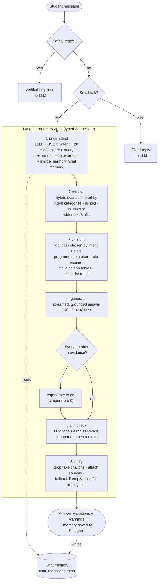
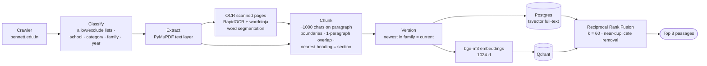

# BENNETT ONE: NLP & Agentic AI Design Document

*How BENNETT ONE turns messy student questions into structured requests, runs them through an agent with tools, and returns answers that are checked against their sources.*

This is the same system as the [GenAI design document](../GenAI/DESIGN.md), seen from the language-processing and agent side. It follows the same template (sections 1–8), then lists the tech stack. Code references point to the files that implement each part.

---

## 1. Problem and users

**The language problem.** Students don't write clean queries. Real examples from our test set (collected from Reddit and student groups):

| What students type | What the system has to work out |
|---|---|
| "PJYSICS 65 AND IT 74" | A typo for Physics; two subject marks |
| "82% in PCM" | A stream average, not a subject. It can't be split into Physics and Maths marks |
| "end sem ke liye attendance kitni chahiye?" | Hinglish for "how much attendance do I need for the end-sem exam?" |
| "what about BBA" | A follow-up: reuse the marks from earlier in the chat, change the programme |
| "can I keep a kettle in the hostel?" | The rule says "electrical appliances"; a kettle belongs to that category |
| "am I eligible for btech cse" | "cse" means B.Tech Computer Science Engineering, not M.Tech CSE or CSE Global |
| "what are IIT Delhi fees?" | Another institution: out of scope |
| "someone is ragging me" | A safety case that must not wait 20 s for a language model |

| User | Task | Success for them |
|---|---|---|
| **Prospective student / parent** | Eligibility, fees, scholarships | A correct verdict for *their* marks, with the official criteria cited |
| **Enrolled student** | Attendance, exams, scholarships, calendar, hostel | A personalised answer for their school, from the current rule, with the page cited |
| **Admin** | Add circulars, see what changed | New documents are versioned and reviewed before they're searchable |

**What they must never get:**
- A misread question answered confidently (wrong programme, wrong marks, wrong intent)
- A detail from earlier in the chat silently dropped or invented
- A sentence that no source supports
- An agent that loops, stalls, or returns nothing

---

## 2. Why NLP + an agent, and which kind

**Why language models at all.** Questions are free text with typos, abbreviations, Hinglish and follow-ups. The knowledge is in unstructured PDFs. Fixed forms and keyword search can't handle either side.

**Which kind of agent.** We compared three designs:

| Option | Verdict | Reason |
|---|---|---|
| Single RAG chain (retrieve → generate) | Baseline | No structured understanding, no tools, no verification. Scored **21/29 (72%)** |
| Autonomous ReAct agent (LLM chooses tools in a loop) | ❌ | A 14B model on a shared GPU picks tools unreliably and each loop step costs 5–10 s. The trajectory changes from run to run, so it can't be unit-tested |
| **Fixed LangGraph workflow with typed state and tools** | ✅ | Each step is a node with one job. The LLM handles language (understand, write, check); code handles routing and decisions. Every run follows a known path we can test and show live |

**Where the LLM is used, and where it is deliberately not used:**

| Task | Technique | LLM? |
|---|---|---|
| Intent classification and slot filling | Schema-constrained JSON from Qwen3-14B | Yes |
| Query rewriting for search | `search_query` field in the same JSON call | Yes |
| Answer writing | Grounded generation from numbered sources | Yes |
| Claim verification | Sentence-level supported / unsupported / not-factual labelling | Yes |
| Eligibility, attendance, scholarship, refund decisions | Rule engine (Python) | **No** |
| Programme and subject normalisation | Abbreviation map + fuzzy matching | **No** |
| Safety, small talk, out-of-scope detection | Regular expressions (including Hindi phrases) | **No** |
| Number checking | Regex extraction + set comparison | **No** |

---

## 3. Scope

**In scope (language side):**
- English questions with typos, abbreviations and informal phrasing
- Hinglish questions (works in testing; not yet a formal test slice)
- Multi-turn chats with remembered marks, scores and programme
- 14 intents plus `out_of_scope` and `greeting`, with about 20 extracted slots (marks, board, CGPA, JEE percentile, attendance per course, withdrawal date, hostel day, letter type and more)
- Letter drafting (leave, condonation, bonafide, internship NOC)
- Questions answered from 364 documents, including the 179-page University Annual Report 2024-25

**Out of scope:**
- Other institutions
- Fully Hindi (Devanagari) questions: untested
- Actions in the real world: the agent reads and explains, it never submits forms or changes records
- Long multi-document reasoning chains ("compare five years of annual reports")

**At the boundary:**

| Situation | Behaviour | Implemented in |
|---|---|---|
| The LLM's JSON can't be parsed | Falls back to intent `general` with the raw question as the search query | `understand()` |
| Unknown intent label | Mapped to `general` (no category filter) | `understand()` |
| Mentions another institution | Overridden to `out_of_scope`, unless the user is comparing with or withdrawing from Bennett | `OTHER_INST` regex |
| Required marks missing | The rule engine returns *insufficient*; code lists exactly what to share | `ask_for_missing()` |
| Ragging / self-harm / emergency | Answered before the graph runs, without the LLM | `agents/safety.py` |

---

## 4. Requirements

### Functional (each one is testable)

| ID | Requirement | How it is tested |
|---|---|---|
| N1 | The understand step returns a valid intent and the slots the question contains | Eval `behavior` check; JSON fallback path |
| N2 | Follow-ups keep the earlier marks and programme; new values replace old ones subject by subject | `tests/test_memory.py` |
| N3 | Typos and abbreviations resolve to the right subject or programme ("PJYSICS", "cse") | `tests/test_rules.py` regression tests |
| N4 | Retrieval only returns current versions, from the user's school or university-wide | Filters inside both searches; superseded-rule test |
| N5 | Every factual sentence is supported by a source; unsupported ones are removed | Claim checker; eval `cited` and `myths` checks |
| N6 | Every number in the answer appears in the evidence, otherwise the answer is regenerated once | `ungrounded_numbers()` + eval |
| N7 | The agent always ends with a non-empty answer or an explicit "not found" | `_fallback_answer()`; eval run 3 fix |
| N8 | Safety messages are answered without the LLM | Safety detector unit tests |

### Non-functional (with targets)

| Property | Target | Current |
|---|---|---|
| End-to-end latency, policy question | median ≤ 25 s | median **20 s**, p90 30 s |
| LLM calls per question | ≤ 4 | 3 (understand, generate, verify); 4 when numbers need regenerating |
| Time to first visible progress | < 1 s | Step events stream immediately over SSE |
| Fast paths (safety, greetings) | < 1 s | Instant |
| Determinism of decisions | Same input → same verdict | Rule engine is pure Python; JSON and verification calls use temperature 0 |
| Privacy | No text leaves campus | Self-hosted Qwen3-14B and bge-m3 |

---

## 5. Architecture

### 5.1 The agent graph (`backend/app/agents/graph.py`)

**Agent state.** One typed dictionary (`AgentState`) flows through every node: the question, recent history, chat memory, user profile, the understanding JSON, retrieved hits, rule result, structured facts, answer, citations, warnings, and an `emit` callback. Each node reads what it needs and returns only the fields it changes, so every step can be inspected and tested on its own.

**Tools the agent uses.** The validate node decides which tools to call from the intent and the slots, not from free-form LLM tool choice:

| Tool | When it's called | Returns |
|---|---|---|
| `search()` (hybrid retrieval) | Every non-trivial question | Top 8 passages with title, page, section, version |
| `_best_match()` (programme matcher) | A programme is mentioned | The official programme name |
| `check_admission()` | Eligibility intent + marks | Verdict, Best-of-3, checks, missing slots |
| `check_attendance()` | Attendance intent, or the student's own ERP data | Per-course verdict against 75% |
| `check_scholarship()`, `check_merit_scholarship()` | Scholarship questions | Continuation verdict or admission band |
| `check_refund()` | Withdrawal date given | Refund amount by date |
| Fee / criteria tables (SQL) | Programme matched | Official fee structure and eligibility text |
| Calendar table | Date questions | Event ranges (e.g. end-sem 10–24 Dec 2026) |

**Streaming.** Nodes call `emit()` with `step`, `sources` and `token` events. FastAPI forwards these as Server-Sent Events, so the user watches "Understanding → Searching → Checking rules → Writing → Checking every claim → Verifying" happen live.

### 5.2 The NLP pipeline behind retrieval (`backend/app/ingest/`, `backend/app/retrieval/`)

**Each component and the requirement behind it:**

| Component | Requirement | Technique |
|---|---|---|
| Understand node | N1 | Intent classification + slot filling + query rewriting in one JSON call |
| `merge_memory` | N2 | Slot-level dialogue state: person facts persist for the chat; topic slots carry over on follow-ups (detected by a regex and short-message heuristic) |
| Abbreviation map + fuzzy matcher | N3 | Normalisation table (cse, ece, ai/ml, llb…) + `SequenceMatcher`, with penalties for PG and dual-degree variants unless asked for |
| Subject typo matching | N3 | `difflib` close matching against known subject names |
| Keyword search (Postgres) | N4 | Stop-word removal, OR-query, `websearch_to_tsquery`, `ts_rank_cd`. Catches codes like "BU/RO/307" and "ABAI3063L" |
| Vector search (Qdrant + bge-m3) | N4 | Multilingual dense retrieval. Catches paraphrases and Hinglish ("end-term" ≈ "end-semester") |
| RRF fusion | N4 | Combines both rankings without calibrating their scores |
| Numeric grounding check | N6 | Regex number extraction, normalised and compared with the evidence |
| Claim checker | N5 | Sentence splitting, filtered to checkable sentences, then LLM labelling |
| Verify node | N7 | Citation repair, fallback answer, deterministic "please share" list |

---

## 6. Failure modes and guardrails

| What can go wrong | Guardrail | Real example it caught |
|---|---|---|
| LLM returns invalid JSON in the understand step | `chat_json` extracts the first `{…}` block; on failure the intent falls back to `general` | — |
| Wrong intent → category filter too strict | If fewer than 3 hits, search again without the category filter | — |
| Abbreviation matched the wrong programme | Abbreviation table + PG/dual-degree penalties | "cse" matched M.Tech CSE |
| A stream average treated as a subject | The engine recognises PCM / PCB / PCMB and an overall % and asks for subject marks | "82% in PCM" → wrongly "does not meet" |
| Typo makes a subject look missing | Fuzzy subject matching | "PJYSICS" → wrongly "not eligible" |
| Follow-up loses earlier details | Structured memory merged by code, not by the LLM | Asked for Physics again after it was given |
| LLM recomputes a number | Code-written verdict line + numeric grounding check + one regeneration | Best-of-3 83.67% written as 88% |
| LLM adds an unsupported sentence | Claim check removes it and tells the user | Invented "personal interview" step |
| A tool raises an error (bad input) | `validate()` catches it, answers without a rule check, and warns | "below 75" crashed the attendance check |
| Verification removes everything | Fallback answer from structured data, or "not found, contact X" | Empty scholarship answer |
| Prompt injection in a retrieved document | Sources wrapped in `<source>` tags and declared as data; admin approval for uploads | — |
| Qwen3 "thinking" text reaches the user | `/no_think` switch + `<think>` stripping, also in the stream | — |
| Vector store or embedder unavailable | Keyword-only degraded search | Qdrant locked during re-indexing |
| SSH tunnel blips | Embedding calls retry with exponential backoff (2–32 s) | Tunnel drop during ingestion |

**What still gets through:**
- The claim checker is the **same model** as the writer, so it can agree with its own mistakes.
- **Attribution can be loose.** Asked about placements "according to the annual report", the agent answered correctly but cited the placements web page instead. The `placement` intent only searches `placement` documents, and the annual report is filed as `general`.
- **Hinglish queries aren't translated** before search, despite the schema asking for English. It works today because bge-m3 is multilingual, but it isn't guaranteed.
- **Implicit intent in Hinglish is missed.** A logged-in student asking "kya main saare courses ke end-sem exam de sakta hu?" gets intent `exam_rules` and `uses_my_attendance: false`, so the attendance tool never runs; the English version works. The claim checker removed the model's guess, so the student saw "not found" rather than a wrong answer (found 18 Nov 2026).
- **Fixed 18 Nov 2026:** after a correct "meets" verdict the model once added that Maths 44 was "below the threshold" and that the rule engine "may be wrong". The generate prompt now forbids contradicting a meets verdict, and marks from earlier turns count as evidence for the number check (they were triggering a false "figures could not be matched" warning).
- The memory's follow-up detection is a heuristic, so an unrelated short message can inherit the previous topic.
- The graph is fixed. Questions that need several dependent lookups ("compare my fee after scholarship for three programmes") rely on a single retrieval pass.

---

## 7. Evaluation plan

**Test set: 31 real student questions** (typos, Hinglish, trick and rule-evasion questions included), each with expected facts, known myths and expected behaviour. Run with `uv run python -m app.eval.run`.

| Slice | # | What it stresses (NLP / agent) |
|---|---|---|
| Scholarships | 7 | Slot extraction (CGPA, JEE percentile, backlogs), tool choice |
| Admissions | 6 | Programme normalisation, marks parsing, asking for missing slots |
| Attendance | 4 | "below 75", per-course numbers, ERP personalisation |
| Fees / refunds | 4 | Date extraction, structured data |
| Hostel | 4 | Category reasoning (kettle → electrical appliance) |
| Out of scope | 2 | Intent override |
| Exams, calendar, campus life, multi-turn | 4 | Memory carry-over, calendar tool |

**Per-stage metrics:**

| Stage | Metric | Status |
|---|---|---|
| Understand | Intent and slot accuracy | Measured indirectly via `behavior`; a labelled intent set is planned |
| Memory | Slot carry-over and replacement | Unit tests |
| Retrieve | Expected source in the cited sources | Eval `cited` check |
| Tools (rule engine) | 41 unit tests, one regression test per bug | CI on every push |
| Generate + verify | Key facts present, no myths, cited, correct behaviour | Eval, 4 checks per answer |
| Agent trajectory | Expected steps emitted (e.g. "Checking eligibility rules") | Visible in the UI; not yet asserted automatically |
| End to end | Pass = all four checks; latency per question | 21/29 → 28/31 → **31/31**; median 20 s |

**Honest caveat:** this question set guided development, so 31/31 means "no regressions on known questions", not a held-out score. The latest run (17 Nov 2026, after adding the Annual Report) is still 31/31.

**Launch thresholds:**
- ≥ 90% on a fresh held-out set of 20+ questions from other students
- ≥ 95% intent accuracy on a labelled set
- Zero wrong verdicts on rule questions

**Human review:** students review 20 sampled answers; admins approve every uploaded document; answers with removed claims carry a visible warning.

---

## 8. Open questions and risks

| Unknown / risk | How we will find out / mitigate |
|---|---|
| True intent and slot accuracy | Label 100 questions with intent and slots; build a confusion matrix |
| Retrieval recall on unseen questions | Label the expected document and page for a held-out set; measure recall@8 |
| Would a tool-calling (ReAct) agent beat the fixed graph on multi-step questions? | Compare on a multi-hop slice once a larger model or GPU is available |
| Hinglish and Hindi | Add a dedicated test slice; translate `search_query` to English explicitly if recall drops |
| Same-model verifier blind spots | Try a smaller separate checker model or an NLI model and compare removals |
| Annual-report questions routed to narrow categories | Add `general` to the category list of intents such as `placement`, then re-run the eval |
| Latency from 3–4 LLM calls | Cache frequent questions; skip the claim check when every sentence is copied from a rule result |

---

## Tech stack

| Layer | Technology | Role in the NLP / agent design |
|---|---|---|
| Agentic framework | **LangGraph** (`StateGraph`, typed state) | Fixed five-node workflow with tool calls inside nodes |
| Language model | **Qwen3-14B** (Q4_K_M) via **Ollama**, OpenAI-compatible API | Intent + slot JSON, grounded generation, claim labelling. `/no_think` for speed |
| Embeddings | **bge-m3** (1024-d, multilingual) | Dense retrieval, Hinglish tolerance |
| Keyword search | **PostgreSQL 18** full-text (`tsvector`, `ts_rank_cd`) | Exact terms, codes and clause numbers |
| Vector store | **Qdrant** (metadata filters inside the search) | School, version and category filtering |
| Fusion | Reciprocal Rank Fusion (k = 60) | Combines keyword and vector rankings |
| Document NLP | PyMuPDF, **RapidOCR**, **wordninja**, custom chunker | Text extraction, OCR, word segmentation, section-aware chunking |
| Normalisation | Python `difflib`, regex abbreviation tables | Typos, abbreviations, programme matching |
| Backend | Python 3.12, FastAPI, Server-Sent Events | Streams agent steps and tokens |
| Frontend | React 19 + TypeScript + Vite + Tailwind | Shows live agent steps, citations and the source viewer |
| Testing | pytest (41 tests), 31-question eval harness, GitHub Actions | Regression safety for tools, memory and classification |
