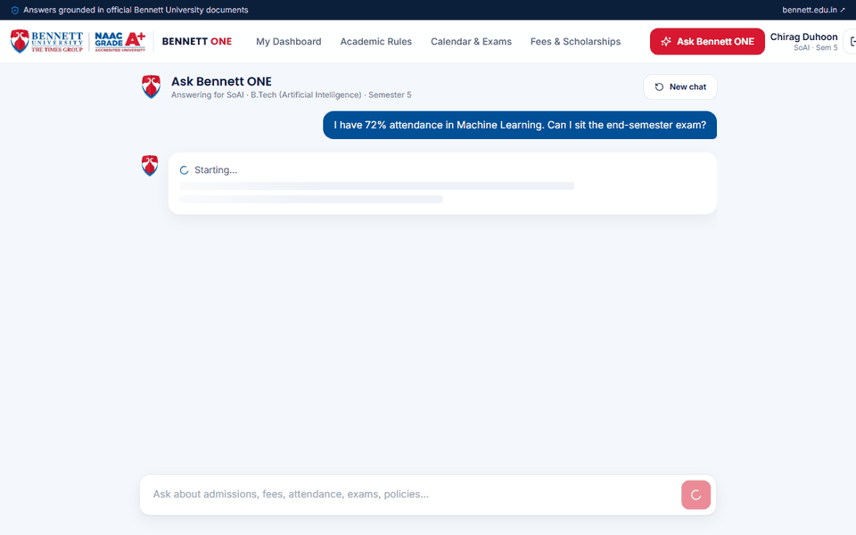
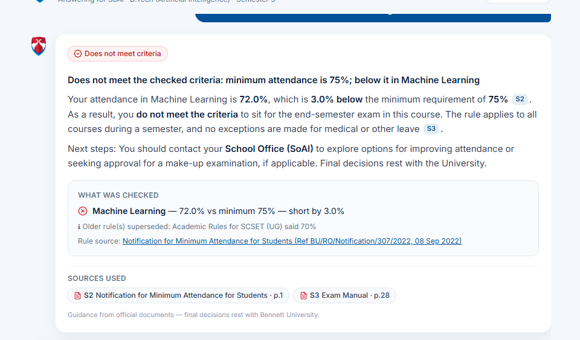
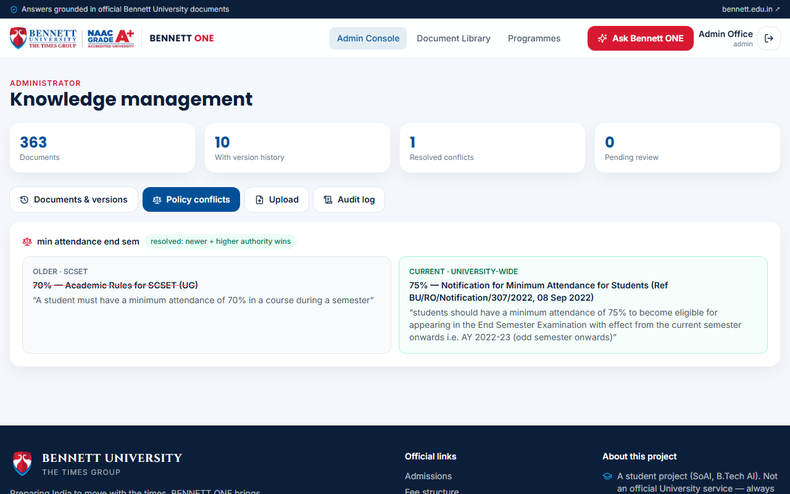

# BENNETT ONE

**A university assistant that answers from official documents, cites the page, and never lets the LLM decide eligibility.**

   



Students at Bennett University ask the same questions every semester: *Can I sit the exam with 72% attendance? Do I keep my scholarship? Am I eligible for B.Tech with these marks?* The answers are spread across 300+ PDFs, notices and fee tables, and some older rules have been replaced by newer ones. BENNETT ONE reads all of it and answers with the source document and page.

> Student project (School of AI, B.Tech AI). Not an official University service.

## Results

Evaluated on **31 real student questions** (mostly collected from Reddit) covering attendance, exams, scholarships, fees, admissions, hostel, calendar, out-of-scope and multi-turn chats. Each answer is scored automatically on four checks: must mention the key facts, must not repeat known myths, must cite an official source, and must behave correctly (e.g. ask for marks instead of guessing).

| Run | Pass rate | What changed |
|---|---|---|
| First full run | 21/29 (72%) | — |
| Fixes 1 | 28/31 (90%) | crash fixes found by the eval, admission deadlines, hostel rules, out-of-scope handling, merit bands, faster prompts |
| **Current** | **31/31 (100%)** | never-empty answers after verification, every scholarship condition listed, criteria stated when asking for marks |

Each bug the evaluation found (e.g. "cse" matching M.Tech instead of B.Tech, JEE treated as a Class XII subject, "below 75" crashing the attendance check) now has a unit test.

| | |
|---|---|
| Answers citing an official source | 29/31 (the other 2 are correct refusals / redirects) |
| End-to-end latency (Qwen3-14B Q4 on one RTX 2000 Ada 16 GB) | median **20 s**, p90 30 s; tokens stream from the first seconds |
| Knowledge base | 363 documents · 380 versions · 7,670 chunks · 133 programmes · 9 schools |
| Unit tests (rule engine, memory, policy versions) | 38 passing in CI |

Full per-question report with every answer: [`data/eval/report.md`](data/eval/report.md). Caveat: the same question set guided development, so treat 100% as "no regressions on known questions", not as a held-out score.

## What makes it different from a chatbot over PDFs

**1. The LLM never decides eligibility.** Attendance thresholds, Class XII "Best of 3" marks, IB credits and scholarship renewals are computed by a tested Python [rule engine](backend/app/rules/engine.py). The LLM only explains the verdict in words. A model that is 95% right is not acceptable for "can I sit my exam?".



**2. Every claim is checked against its source.** After Qwen writes an answer, a second strict pass labels each sentence as supported or unsupported against the exact passages, rule results and fee tables, and unsupported sentences are removed. A numeric grounding check also requires every number (%, ₹, dates) to appear in the evidence. If one doesn't, the answer is regenerated. This caught a real bug: the rule engine computed Best-of-3 = 83.67%, but the LLM had written 88%.

**3. It knows when rules change.** Documents are versioned. When a newer notification overrides an older one (SCSET's 70% attendance rule was replaced by the university-wide 75% in Sep 2022), the conflict is detected, resolved by recency and authority, and shown to admins.



**4. Hybrid retrieval.** Dense vectors (bge-m3) catch paraphrases ("end-term" vs "end-semester"). Postgres full-text search catches exact codes and names. The two are fused with Reciprocal Rank Fusion and filtered by the student's school and academic year.

**5. Self-hosted model.** Qwen3-14B runs on a campus GPU through Ollama's OpenAI-compatible API. No student data leaves campus, and switching to another provider is a `.env` change.

## Architecture

```
React 19 + Tailwind ──SSE──►  FastAPI  ──►  LangGraph agent
                                             understand → retrieve → validate → generate → verify
                                                 │           │           │           │          │
                                       intent + memory   hybrid search  rule engine  Qwen3-14B  citation verifier
                                                         (Qdrant +      (Python,     (Ollama,   + numeric guard
                                                          Postgres FTS)  tested)      GPU)
```

Ingestion: crawl bennett.edu.in → classify → extract text (OCR for scanned PDFs) → chunk by section → version → embed.

**Documents:**
- [docs/DESIGN.md](docs/DESIGN.md): the design document. It covers problem and users, why RAG plus rules, scope, requirements, the architecture diagram, failure modes, the evaluation plan, risks and the tech stack.
- [docs/HOW_IT_WORKS.md](docs/HOW_IT_WORKS.md): the detailed walkthrough of every component and decision.
- [docs/DEMO_SCRIPT.md](docs/DEMO_SCRIPT.md): the 15-minute demo plan and Q&A preparation.

## Run it

Needs: Python 3.12 + [uv](https://docs.astral.sh/uv/), Node 20+, PostgreSQL, and an Ollama server with `Qwen3-14B` and `bge-m3` (any OpenAI-compatible endpoint works).

```powershell
cp backend/.env.example backend/.env    # set GPU_SSH_HOST, JWT_SECRET, model names
.\scripts\start.ps1                     # database, GPU tunnel, API and web app
# web: http://localhost:5173   API docs: http://localhost:8000/docs
```

Demo accounts (password `bennett123`): `student@bennett.demo` (SoAI, Semester 5) and `admin@bennett.demo`.

**Build the knowledge base**

```powershell
python scraper/crawl.py                              # crawl bennett.edu.in (polite, cached)
python scraper/parse_seed.py                         # structured data -> data/seed/*.yaml
cd backend
uv run python -m app.db.load_seed                    # schools, programmes, criteria, fees
uv run python -m app.ingest.ocr                      # OCR scanned PDFs (slow, cached)
uv run python -m app.ingest.pipeline --reset         # chunk + embed + index (stop the API first)
```

**Test and evaluate**

```powershell
cd backend
uv run pytest -q                  # rule engine + memory + policy versions (no GPU or DB needed)
uv run python -m app.eval.run     # 31-question evaluation against the running API
```

## Repository layout

| Path | What |
|---|---|
| `backend/app/agents/graph.py` | LangGraph agent, verdict line, numeric hallucination guard, citation verifier |
| `backend/app/rules/engine.py` | eligibility (Best-of-3, IB, graduation), attendance, scholarships, superseded rules |
| `backend/app/retrieval/hybrid.py` | vector + keyword search, RRF fusion, school/version filters |
| `backend/app/ingest/` | classify → extract/OCR → chunk → version → embed |
| `backend/app/eval/run.py` + `data/eval/gold.yaml` | evaluation harness and question set |
| `frontend/src/` | React app: chat with live agent steps, eligibility checker, dashboard, admin console |
| `scraper/` | crawler, PDF fetcher, structured-data parser |

Crawled PDFs, the database and the vector index are not committed (`data/raw`, `data/pg`, `data/qdrant`). They are rebuilt with the commands above. University logos and photos (`frontend/public/brand/`) are also not committed.

## License

MIT, for the code. University documents, names and logos belong to Bennett University.
